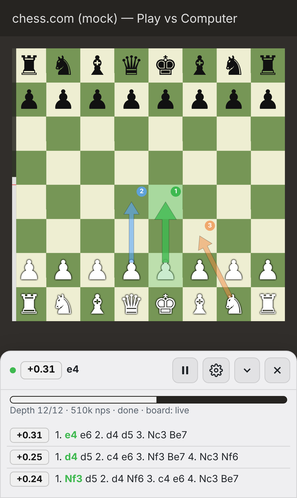
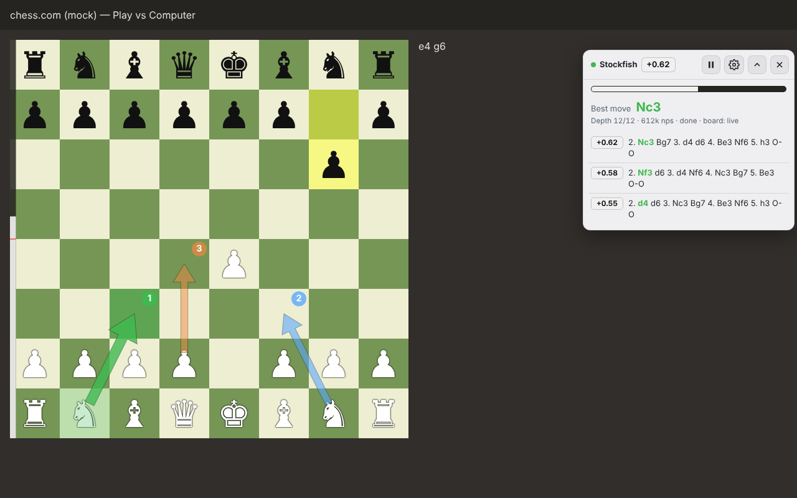

# Chess-bot: Stockfish overlay for Chess.com bot games

Open Chess.com in your browser, start a game against a bot, and a Stockfish analysis panel appears on the page. It shows the evaluation, the best move, candidate lines, search depth, arrows on the board and an eval bar. **It works on iPhone** through Safari and the free *Userscripts* extension.

| iPhone (docked panel) | Desktop (floating panel) |
| --- | --- |
|  |  |

*(The screenshots come from the test harness's mock of the Chess.com board. On the real site, Chess.com's own board graphics are underneath the overlay.)*

## Features

- **Board detection.** Finds Chess.com's board and reads the position as FEN. It uses the board's built-in game API when available and otherwise falls back to parsing the piece elements. Side to move, castling rights and en passant are inferred from the last-move highlight and from move history.
- **Local Stockfish 19.** The single-threaded "lite" WebAssembly build runs in a Web Worker on your own device. It is downloaded once (about 1.9 MB) and then cached, and no positions are sent to any server.
- **Analysis panel.** Shows the eval in White's view, an eval bar, the best move in SAN, up to 5 candidate lines in SAN, depth and nodes per second.
- **Board annotations.** Numbered arrows for the top candidate moves, highlighted best-move squares and a slim eval bar on the board edge. All of them follow board size and orientation.
- **Settings:**
  - Search mode: fixed depth, time per move or infinite.
  - Search depth or time, number of lines (MultiPV), engine skill level and hash size.
  - Show suggestions on every move or only on your turn.
  - Arrow count, arrow opacity, number labels and square highlights.
  - Theme (system, dark or light), accent colour, panel transparency, text size, and a floating or docked layout.
- **Phone-friendly.** On narrow screens the panel docks to the bottom of the screen and fits under the board where possible. Controls are touch-sized and the panel can be collapsed. A ✕ button hides the panel and a ♞ button brings it back.
- **Only on bot games and the analysis board.** The overlay switches itself on only on `chess.com/play/computer` and `chess.com/analysis`. It stays off in games against people, because engine help there breaks Chess.com's fair-play rules and gets accounts closed.

## Install on iPhone / iPad

You need iOS 16 or newer, and you must use **Safari**. The Chess.com app cannot run extensions.

1. Install **Userscripts** from the App Store. It is free and open source, made by Justin Wasack.
2. Open the Userscripts app once. It creates a scripts folder (by default *On My iPhone › Userscripts*).
3. Turn on the extension: **Settings → Apps → Safari → Extensions → Userscripts → Allow Extension**. Then set *chess.com* (or *All Websites*) to **Allow**.
4. Add the script, using one of these options:
   - **From a link.** Open the raw file [`dist/stockfish-overlay.user.js`](dist/stockfish-overlay.user.js) in Safari. Tap the **Userscripts** icon in Safari's toolbar (in the *aA* / puzzle-piece menu) and tap **Install**. This only works if the repository is public.
   - **As a file.** Download `stockfish-overlay.user.js` and use the Files app to move it into the Userscripts folder.
5. Open **https://www.chess.com/play/computer** in Safari and start a game against any bot. The panel appears at the bottom of the screen. The first time, it downloads the engine (a few seconds).

## Install on desktop (Chrome, Edge, Firefox, Safari)

1. Install **Violentmonkey** or **Tampermonkey**.
2. Open [`dist/stockfish-overlay.user.js`](dist/stockfish-overlay.user.js) as a raw file and the extension will offer to install it. Or create a new script and paste the file's contents.
3. Go to https://www.chess.com/play/computer.

Shortcut: **Alt + Shift + S** shows or hides the panel.

## Using it

| Control | What it does |
| --- | --- |
| ⏸ / ▶ | Pause or resume analysis. Pausing also removes the arrows. |
| ⚙ | Opens settings. Tap ‹ to go back. |
| ⌄ / ⌃ | Collapses the panel to one line (eval and best move) or expands it again. |
| ✕ | Hides the panel. Tap the round ♞ button to bring it back. |
| Drag header | Moves the floating panel (desktop layout). |

Settings are saved in your browser's local storage on chess.com. **Advanced → Reset settings** restores the defaults.

### Settings reference

| Setting | Default | Notes |
| --- | --- | --- |
| Search | Fixed depth 18 | *Time per move* is gentler on phone batteries. |
| Candidate lines | 3 | MultiPV, from 1 to 5. |
| Engine strength (skill) | Max (20) | Lower values make the engine suggest weaker moves. |
| Hash memory | 16 MB | Keep this low on phones. |
| Show suggestions | Every move | *Only on my turn* hides moves and arrows while the bot is thinking. |
| Arrows / count / opacity / labels | On / 3 / 80% / On | |
| Eval bar on board | On | A thin bar inside the left edge of the board. |
| Theme / accent / transparency / text size / layout | System / green / 95% / 100% / Automatic | *Automatic* docks the panel on screens narrower than 700 px. |
| Engine URL | jsDelivr `stockfish@19.0.1` lite single-threaded build | Any `stockfish-*-single.js` URL works if its `.wasm` file sits next to it. |

## Troubleshooting

- **"Engine failed to load".** Check your connection and tap ▶ to retry. If jsDelivr is blocked on your network, set *Engine URL* to another host, for example `https://unpkg.com/stockfish@19.0.1/bin/stockfish-19-lite-single.js`. **Re-download engine** clears the cached copy.
- **No panel.** Make sure you are on `chess.com/play/computer` or `chess.com/analysis` in Safari, not the Chess.com app, and that the Userscripts extension is allowed on chess.com.
- **"Could not read this position".** Chess.com may have changed its board markup. The panel footer shows `board: live` (game API) or `board: DOM` (parsing pieces). Please open an issue with the page URL.
- **Slow on an older iPhone.** Lower the depth, switch to *Time per move*, or use fewer candidate lines. Low Power Mode also slows the engine down.

## How it works

```
src/
  chess.js     rules engine: FEN, legal moves, UCI → SAN (verified against chess.js with perft)
  board.js     finds <wc-chess-board>, reads the position (game API or DOM), orientation, side
  engine.js    downloads and caches Stockfish, starts it in a Blob Web Worker, UCI parsing, search queue
  overlay.js   SVG arrows, square highlights and the eval bar, placed inside the board element
  settings.js  persisted preferences
  panel.js     Shadow-DOM panel UI: analysis view and settings view
  main.js      page gating, polling and MutationObserver, wiring everything together
scripts/build.js   bundles src/ into dist/stockfish-overlay.user.js
test/              unit tests, plus an end-to-end test against a mock Chess.com page
```

Stockfish's `.wasm` file is downloaded by the page and passed to the worker in a message. A small `fetch` shim inside the worker hands those bytes to the engine. This means the engine never makes a network request of its own and nothing has to be hosted on chess.com.

## Development

```bash
npm install          # dev dependencies: chess.js (reference) and stockfish (engine files for the tests)
npm run build        # writes dist/stockfish-overlay.user.js
npm test             # rules and SAN unit tests
npm run test:e2e     # build, then drive the mock board in Chromium with the real WASM engine
```

The end-to-end test serves `test/mock/play-computer.html`, a small copy of Chess.com's board markup, and injects the built userscript. It checks:

- engine startup, analysis and arrows;
- FEN reading from the DOM alone;
- arrow placement on a flipped board;
- that the overlay stays off on `/play/online`;
- the iPhone layout (docking, settings, collapse and hide).

Screenshots are written to `test/screenshots/`.

Stockfish.js (by Nathan Rugg, based on Stockfish) is GPL-3.0 licensed. It is loaded at runtime and is not bundled in this repository.
